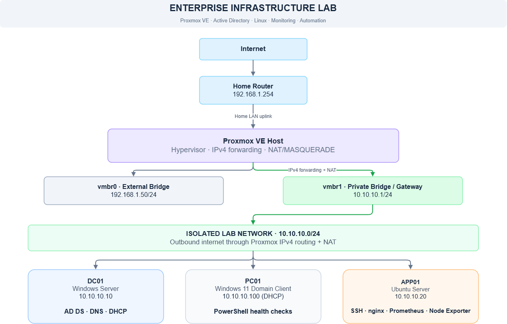
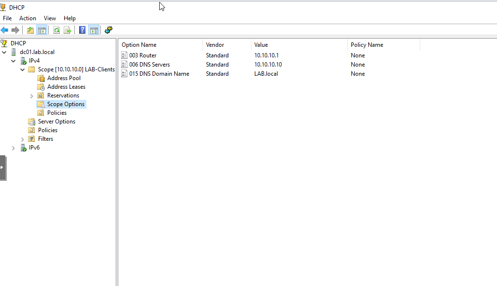
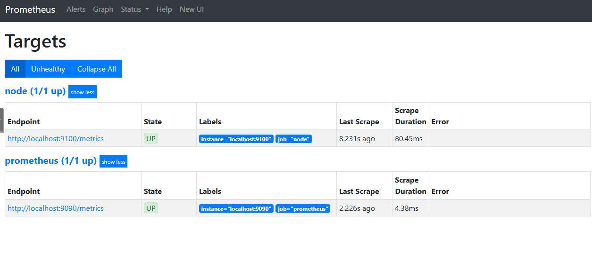
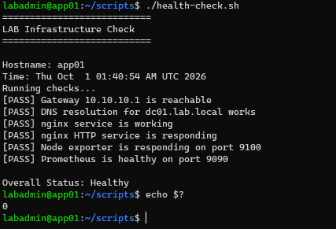

# Enterprise Infrastructure, Networking & Monitoring Home Lab

## Project Overview

Designed and built a virtualized enterprise style infrastructure lab using Proxmox VE to gain hands on experience with Windows Server administration, Active Directory, networking, Linux services, infrastructure monitoring, automation, and incident troubleshooting.

The environment includes an isolated private network, a Windows Server domain controller, a domain joined Windows 11 workstation, and an Ubuntu application server. Routing and NAT provide outbound connectivity while separating the lab network from the home LAN.

The project also includes automated health checks and simulated infrastructure incidents to practice diagnosing, resolving, and validating technical issues.

## Technologies Used

| Category             | Technologies                                            |
| -------------------- | ------------------------------------------------------- |
| Virtualization       | Proxmox VE                                              |
| Operating Systems    | Windows Server, Windows 11, Ubuntu Server               |
| Identity & Directory | Active Directory Domain Services, Group Policy          |
| Networking           | TCP/IP, DNS, DHCP, IPv4 routing, NAT, Linux bridges     |
| Application Services | nginx, SSH                                              |
| Monitoring           | Prometheus, Node Exporter, PromQL                       |
| Automation           | Bash, PowerShell                                        |
| Troubleshooting      | systemctl, journalctl, ss, nslookup, Test-NetConnection |

## Network Architecture

The lab operates on a private `10.10.10.0/24` network connected to the Proxmox host through `vmbr1`.

The Proxmox host provides IPv4 forwarding and NAT, allowing lab systems to access external resources without placing them directly on the home LAN.

| Component     | IP Address          | Role                                     |
| ------------- | ------------------- | ---------------------------------------- |
| Home Router   | 192.168.1.254       | Home network gateway                     |
| Proxmox vmbr0 | 192.168.1.50        | External network bridge                  |
| Proxmox vmbr1 | 10.10.10.1          | Lab gateway                              |
| DC01          | 10.10.10.10         | Active Directory, DNS, DHCP              |
| PC01          | DHCP (10.10.10.100) | Windows 11 domain client                 |
| APP01         | 10.10.10.20         | Ubuntu application and monitoring server |

### Network Diagram



## Windows Server Infrastructure

Configured Windows Server as a domain controller for the `LAB.local` AD domain.

Key configurations included:

- Installed and configured AD Domain Services.
- Configured DNS to support domain services and internal hostname resolution.
- Installed and authorized DHCP in Active Directory.
- Created a DHCP scope for `10.10.10.100–10.10.10.200`.
- Configured DHCP options for the default gateway, DNS server, and domain name.
- Joined a Windows 11 workstation to the domain.
- Verified client addressing, DNS resolution, and domain connectivity.

### DHCP Scope Configuration

The DHCP scope provides clients with the lab gateway,
internal DNS server, and Active Directory domain name.



## Linux Application Server

Deployed an Ubuntu Server virtual machine with a static IP address of `10.10.10.20`.

Configured and validated:

- SSH for remote administration.
- nginx for HTTP web services on TCP port 80.
- Internal DNS resolution using `app01.lab.local`.
- Service management using `systemctl`.
- Service and application troubleshooting using `journalctl`, `ss`, and HTTP connectivity tests.

## Infrastructure Monitoring

Deployed Prometheus and Node Exporter on APP01 to collect and query Linux system metrics.

Validated Prometheus scrape targets and used PromQL to inspect:

- CPU utilization
- Memory utilization
- Network activity
- Monitoring target availability

Services:

- Prometheus: TCP port 9090
- Node Exporter: TCP port 9100

### Monitoring Validation

Verified that Prometheus successfully scraped
metrics from Node Exporter.



## Automated Health Checks

Developed two complementary scripts to validate infrastructure health.

### Bash — Server-Side Health Check

The Bash script runs on APP01 and checks:

- Lab gateway connectivity
- Internal DNS resolution
- nginx service status
- HTTP availability
- Node Exporter metrics endpoint
- Prometheus health endpoint

The script reports individual test results and returns exit code `0` when all checks pass or `1` when one or more checks fail.

**Script:** `scripts/health-check.sh`

### Health Check Validation

Example output from the server-side Bash health check.



### PowerShell — Client-Side Health Check

The PowerShell script runs on PC01 and checks:

- Domain controller connectivity
- Internal DNS resolution
- SSH availability
- HTTP availability
- Prometheus availability
- Node Exporter availability

The script reports the overall infrastructure status and uses exit codes to indicate success or failure.

**Script:** `scripts/Test-LabHealth.ps1`

## Incident Troubleshooting

Performed two controlled outage simulations to practice systematic troubleshooting.

### INC-001 — nginx Web Service Outage

**Issue:** The internal website became unavailable after the nginx service was intentionally stopped.

**Diagnosis:** Confirmed the failure from PC01, inspected service status and logs on APP01, and checked listening TCP ports.

**Resolution:** Restarted nginx and verified that the service was listening on port 80 and accessible from PC01.

**Result:** Restored connectivity and confirmed all health checks passed.

[View INC-001 Incident Report](incidents/INC-001-nginx-outage.md)

### INC-002 — Internal DNS Resolution Failure

**Issue:** PC01 could no longer resolve `app01.lab.local` after its DNS configuration was changed to a public resolver.

**Diagnosis:** Confirmed hostname resolution failed while direct IP connectivity to APP01 on port 80 remained successful.

**Resolution:** Restored DHCP-provided DNS settings and cleared the DNS client cache.

**Result:** Confirmed the hostname resolved to `10.10.10.20`, HTTP connectivity succeeded, and the health-check script passed.

[View INC-002 Incident Report](incidents/INC-002-dns-resolution-failure.md)

## Skills Demonstrated

- Virtual machine deployment and administration
- Network segmentation, IPv4 routing, and NAT
- Windows Server and Active Directory administration
- DNS and DHCP configuration and troubleshooting
- Linux service administration
- Infrastructure monitoring with Prometheus
- Bash and PowerShell scripting
- Layered troubleshooting and root-cause analysis
- Technical incident documentation and validation

## Project Structure

```text
enterprise-infrastructure-lab/
├── README.md
├── diagrams/
│   └── network-topology.png
├── scripts/
│   ├── health-check.sh
│   └── Test-LabHealth.ps1
├── incidents/
│   ├── INC-001-nginx-outage.md
│   └── INC-002-dns-resolution-failure.md
└── screenshots/
    ├── network/
    ├── active-directory/
    ├── monitoring/
    └── incidents/
```

## Project Status

**Completed**

- Deployed and configured the virtualized infrastructure environment.
- Implemented Active Directory, DNS, DHCP, Linux services, and infrastructure monitoring.
- Developed and tested Bash and PowerShell health-check scripts.
- Completed and documented two simulated infrastructure incidents.
- Added network documentation, scripts, and supporting technical evidence.
