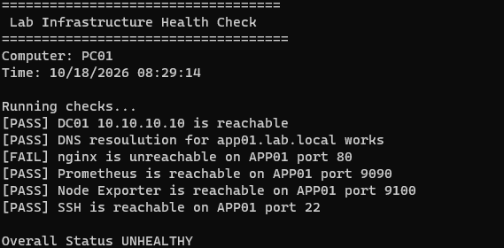
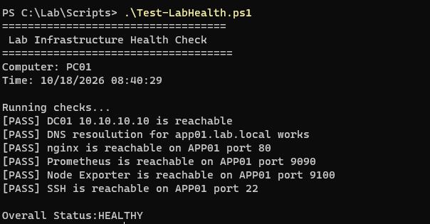

# INC-001 — nginx Web Service Outage

**Incident Type:** Application / Web Service Outage  
**Affected System:** APP01 — Ubuntu Server (`10.10.10.20`)  
**Affected Service:** nginx (HTTP, TCP port 80)  
**Status:** Resolved  
**Environment:** Proxmox home lab (`10.10.10.0/24`)

## Issue Summary

A simulated incident was created by intentionally stopping the nginx service on APP01. The Windows 11 domain client (PC01) could no longer connect to the internal web server.

## Troubleshooting Steps

1. Ran the PowerShell health check script on PC01, which detected a failure connecting to nginx on TCP port 80.
2. Checked network connectivity and service availability using `Test-NetConnection`.
3. Connected to APP01 using SSH and examined nginx service status with `sudo systemctl status nginx`.
4. Confirmed nginx was `inactive (dead)`.
5. Reviewed recent service logs using `sudo journalctl -u nginx -n 20 --no-pager`, which showed the service had stopped.
6. Inspected listening TCP ports using `sudo ss -tlnp` to check whether nginx was listening on port 80.

## Root Cause

The nginx service was intentionally stopped using `sudo systemctl stop nginx` as part of a controlled outage simulation. This prevented HTTP connections to the internal web server.

## Resolution

Restarted the nginx service using:

`sudo systemctl start nginx`

Verified that nginx was listening on TCP port 80 using `sudo ss -tlnp`.

## Validation

- Confirmed nginx was listening on IPv4 and IPv6 interfaces.
- Verified HTTP port 80 was reachable from PC01.
- Re-ran the PowerShell health-check script on PC01.
- All health checks passed, and the script returned exit code `0`.

**Final Status:** Resolved — service restored and validated from the client workstation.

## Evidence

### Service Failure

### Service Restored

## Key Takeaway

A failed application connection does not necessarily indicate a network wide outage. Testing individual services and checking server-side service status and logs helps isolate the cause before applying a fix.
