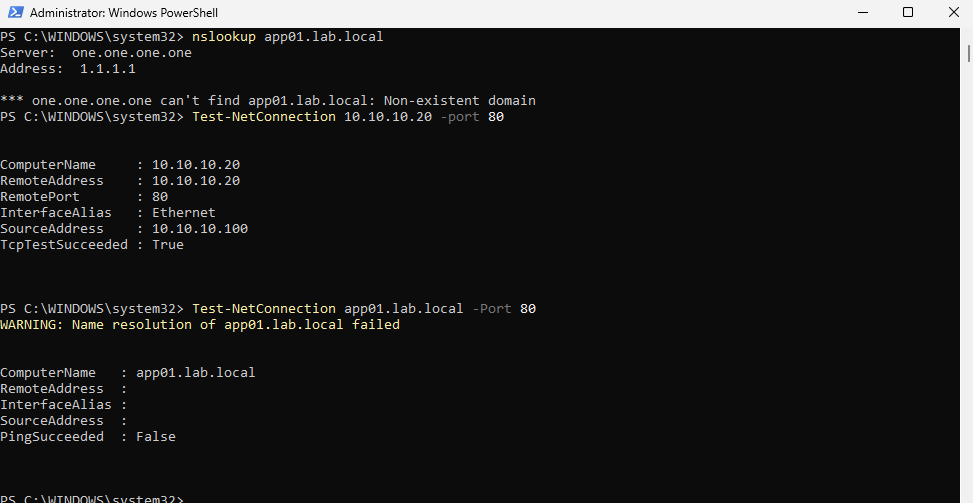
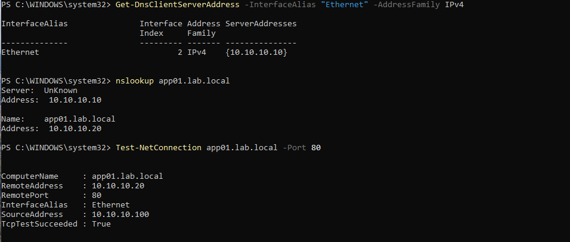

# INC-002 — Internal DNS Resolution Failure

**Incident Type:** DNS / Client Network Configuration  
**Affected System:** PC01 — Windows 11 Domain Client (`10.10.10.100`)  
**DNS Server:** DC01 (`10.10.10.10`)  
**Status:** Resolved  
**Environment:** Proxmox Home Lab (`10.10.10.0/24`)

## Issue Summary

A simulated incident was created by changing PC01's DNS server from the domain controller to the public DNS server `1.1.1.1`. The client could no longer resolve the internal hostname `app01.lab.local`, preventing access to the internal web application by hostname.

## Troubleshooting Steps

1. Used `nslookup app01.lab.local` to test DNS resolution.
2. Confirmed that the configured public DNS server returned a non-existent domain response.
3. Used `Test-NetConnection 10.10.10.20 -Port 80` to verify that the web server remained reachable by IP address.
4. Used `Test-NetConnection app01.lab.local -Port 80` to confirm hostname-based connectivity failed.
5. Compared successful IP connectivity against failed hostname resolution to isolate the issue to DNS configuration.

## Root Cause

PC01 was intentionally configured to use `1.1.1.1` instead of the internal Active Directory DNS server `10.10.10.10`. The public resolver could not resolve the private `LAB.local` hostname.

## Resolution

Restored DHCP-provided DNS settings:

`Set-DnsClientServerAddress -InterfaceAlias "Ethernet" -ResetServerAddresses`

Cleared the DNS client cache:

`Clear-DnsClientCache`

## Validation

- Confirmed PC01 was using DNS server `10.10.10.10`.
- Verified `app01.lab.local` resolved to `10.10.10.20`.
- Confirmed TCP connectivity to the internal web server on port 80 succeeded.

**Final Status:** Resolved — DNS configuration restored and internal hostname connectivity verified.

## Evidence

### DNS Resolution Failure

### DNS Resolution Restored

## Key Takeaway

Successful IP connectivity combined with failed hostname resolution helps distinguish DNS configuration problems from network routing or application service failures. Active Directory clients should use the appropriate internal DNS infrastructure to resolve domain resources.
